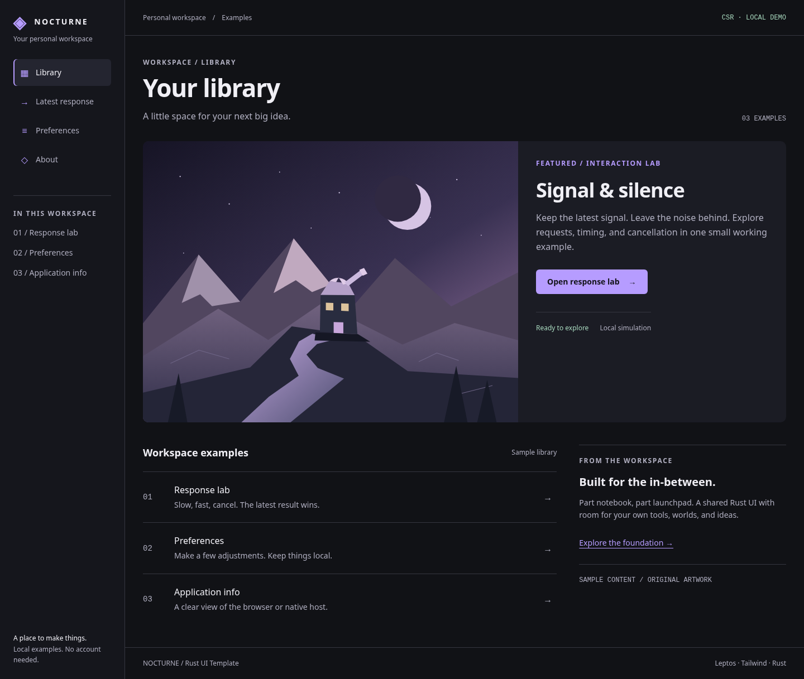

# rust-ui-template

**Status: browser and Linux desktop slices; not a complete cross-platform release.** The shared Leptos UI uses the dependency-free core. An Ubuntu 24.04 Debian package has build, installation and WebKit launch evidence; other native platforms remain future work.

A minimal Rust-first UI foundation for browser, desktop, and mobile clients. The template will be implemented incrementally through the repository's GitHub issues.

## Implemented foundation

`crates/app-core` provides a latest-request-wins state tracker without UI or platform dependencies. Its tests cover stale, duplicate and cancelled responses, non-wrapping request IDs, and bounded event sequences. The adapter, not the core, owns actual I/O and task cleanup.

```sh
cargo fetch --locked
cargo test --workspace --locked --offline
```

See the [coding-agent handoff and full check commands](docs/issue-1-handoff.md), [decision D-0002](knowledge/decisions/D-0002-latest-request-core.md), and [execution evidence O-0002](knowledge/observations/O-0002-core-foundation.md). A successful core test is not a browser, desktop, or mobile launch test. Issue #1 remains open.

## Default workspace

Nocturne combines Obsidian-like workspace organization with a game-launcher-style
featured library. It ships original local artwork, dark semantic tokens, shared
controls and responsive navigation. [Design guide](docs/default-design.md) ·
[Mobile preview](docs/images/nocturne-mobile.png).



Choose from Nocturne and six additional [color schemes](docs/color-palettes.md)
in **Preferences → Appearance**. The choice applies across the current session.

## Browser development

Install Rust 1.99.1 with the `wasm32-unknown-unknown` target, Python 3,
Chrome or Chromium, and Trunk 0.21.14 (`cargo install trunk --version 0.21.14 --locked`).
Node and npm are not required. From the repository root:

```sh
python3 scripts/setup_frontend.py
cargo fetch --locked
.tools/tailwindcss -i styles/input.css -o styles/generated.css --minify
python3 scripts/check_css.py
trunk build --release --locked
trunk build --release --locked --public-url /sub/ --dist dist/sub
cargo run -p browser-tests --locked --offline
```

The setup script verifies the official Tailwind 4.3.4 executable and axe-core
4.10.3 test asset against committed hashes. On Windows, use `.tools/tailwindcss.exe`.
Linux musl is detected automatically; `TAILWIND_TARGET` can explicitly select a
pinned asset name from `scripts/tool-assets.json`. Set `CHROMIUM_PATH` if
Chrome/Chromium is not discoverable. Sandboxing is enabled
by default; `CHROMIUM_NO_SANDBOX=1` is available only for restricted containers
that cannot launch Chromium's sandbox. If your environment sets `NO_COLOR=1`,
unset it for Trunk 0.21.14, which expects a boolean string.

The second build exercises a `/sub/` asset base; use the matching `--public-url`
for a different deployment path. Navigation uses URL fragments and requires no
route rewrite. The Rust browser runner serves the production files on an ephemeral
loopback port, checks interactions and accessibility, and writes actual screenshots
to `artifacts/response-lab.png`, `artifacts/workspace-overview.png`, and
`artifacts/preferences.png`.

The initial URL opens the Nocturne library. Example routes are `#/` (response lab), `#/overview` (library), and
`#/settings` (preferences form). Library content and artwork are examples. Preferences
are local component state and reset on navigation; no persistence or network API
is implemented. Browser binaries come from the environment; their versions must
be recorded with test results. Other system browsers/WebViews remain unverified.

## Linux desktop host

The Tauri 2 host embeds the same production `dist/` as the browser and has an
isolated Cargo workspace/lockfile in `apps/native` so GTK dependencies do not
enter browser-only checks. Its only application command is a versioned,
read-only `app_info`, granted to the local `main` window on Linux. About shows
the native result or an explicit unavailable message in a browser.

On Ubuntu 24.04, install `libwebkit2gtk-4.1-dev`, `libayatana-appindicator3-dev`,
`librsvg2-dev`, and `patchelf`. Build the root production assets as above, then:

```sh
trunk build --release --locked
python3 scripts/setup_native_cli.py
cargo fetch --manifest-path apps/native/Cargo.toml --locked
(cd apps/native && ../../.tools/cargo-tauri tauri build --bundles deb -- --locked)
```

The CLI setup script pins the official Linux x86_64 Tauri 2.12.4 binary and hash;
other development platforms can install the same version with
`cargo install tauri-cli --version 2.12.4 --locked` but are untested here.
The root rebuild removes the browser test’s nested `dist/sub` fixture before
embedding assets, matching CI. Linux CI installs the Debian package and launches it under Xvfb using
`tauri-driver` 2.1.0 and `WebKitWebDriver` (`webkit2gtk-driver` package):

```sh
cargo install tauri-driver --version 2.1.0 --locked
sudo dpkg -i apps/native/target/release/bundle/deb/*.deb
xvfb-run -a python3 scripts/native_smoke.py
```

The separate `tauri.e2e.conf.json` replaces the window with a restricted one for a real permission
denial test; its bundle is a test fixture, not the production package. Production
CSP allows the bundled scripts and WASM while blocking arbitrary inline scripts.
See the [platform evidence matrix](docs/platforms.md) for verified and untested targets.
No signing/notarization, persistence, mobile build or general platform support
claim is made. See the knowledge records for exact execution evidence.

[DEB/RPM package validation](docs/linux-packages.md) describes the Ubuntu and
Fedora targets, metadata checks, diagnostics and unsigned artifacts.

## Selected architecture

- **Leptos** owns UI components, client-side routing, and reactive presentation state.
- **WebAssembly** executes the browser client build; browser-facing glue remains explicit.
- **Tailwind CSS 4** provides one shared styling pipeline.
- **Tauri 2** packages the same client for desktop (Windows, macOS, Linux) and mobile (Android, iOS), with native functionality behind narrow capability-scoped adapters.
- **Pure Rust core** owns reusable application rules and state transitions, independent of UI, browser, or operating-system APIs.

The core workspace pins Rust 1.99.1 with Edition 2024/resolver 3. The remaining implementation roadmap calls for current Leptos APIs, Tailwind 4 CSS-first configuration, explicit Tauri custom-command ACLs/CSP, locked builds, and least-privilege CI. The browser slice pins its dependencies and build tools; native toolchain compatibility remains to be established.

## Release sequence

1. **v0.1, client-side rendering:** establish a single Leptos CSR frontend usable in the browser and through Tauri 2, with build/test/packaging evidence. No server-rendering dependency in the client bundle.
2. **Follow-up, optional web SSR + hydration:** add a separate web deployment profile using the same components where technically justified. Keep Tauri clients on CSR; do not introduce a parallel UI framework.

See [Architecture and verification scope](docs/architecture.md) and the repository's GitHub Issues for implementation plans and acceptance criteria.

## Agent design and review workflow

The template ships a [local distinct UI skill](.agents/skills/distinct-ui/SKILL.md):
write a task brief, compare structural directions, specify geometry, implement,
then inspect real desktop/mobile captures and metrics. No design-service account
is required. The [default Nocturne design](docs/default-design.md) combines a dark workspace
rail with a featured library and launch action, using original local artwork.
The optional [restricted theme](design/restricted-theme.css) is a
starting profile, not the existing demos' mandatory style. See the
[research review](knowledge/research/R-0002-ui-diversity-and-verification.md) for
which AI-sameness claims are supported and which remain hypotheses.

Production browser checks now include desktop, 390px and 320px layout/axe checks.
Screenshots and `layout-*.json` reports are written to `artifacts/` and uploaded
by browser CI. [CI documentation](docs/ci.md) explains verified tools, trusted
caches and cold/warm measurement. Human review uses the [overall diagrams](docs/architecture.md)
and [change diagrams](docs/design-ci-change.md); reviewer effort is standard/medium,
with max/ultra prohibited.

## Collaboration and linked knowledge

- [AGENTS.md](AGENTS.md): minimal, repo-wide working agreement for coding agents (`develop` for autonomous agent stacks, `main` gated by human review).
- [CONTRIBUTING.md](CONTRIBUTING.md): the authoritative, issue-agnostic contributor guide covering the iterative development loop, the `develop` vs. `main` branch model ([`.github/workflows/main-human-gate.yml`](.github/workflows/main-human-gate.yml)), colocated Jujutsu (`jj`) and stacked PR workflows, cross-model agentic review & stack merge ownership, commit conventions ([`.github/.gitmessage`](.github/.gitmessage)), and the PR template ([`.github/pull_request_template.md`](.github/pull_request_template.md)).
- [Knowledge graph](knowledge/README.md): linked, dated decisions (`D-`), research (`R-`), and observations (`O-`) that track provenance (`added_by: agent | human | mixed`) and explicit human sign-off (`human_ratified: true | false`) without gating agent velocity.
- [docs/](docs/architecture.md) remains relatively stable documentation; `knowledge/` records evolving understanding and must not be treated as proof of implementation.


## Deliberately excluded from the baseline

Topcoat, htmx, Electron, parallel reactive frameworks, custom mount coordinators, and an embedded HTTP server in the native shell.

## Verification standard

The template should state only what its tests and proofs establish. A Lean proof over a handwritten model does not verify Leptos or the shipped WebView. Formal verification, if introduced, must be tied to supported Rust source extraction and explicitly scoped invariants; platform interactions require independent integration tests.

## Licenses and platform support

Licensed under the [MIT License](LICENSE) (Copyright 2026 Kennedy Mosoti). The validated platform-support matrix remains a release decision; public repository visibility alone does not establish platform support.

## Android test APK workflow

The generated Tauri Android host reuses the same UI/core and production assets.
See [Android build/instrumentation guide](docs/android.md) and the
[platform evidence matrix](docs/platforms.md) for current validation and limits.
APKs are debug/test-signed; store signing, iOS and other desktop ports are deferred.
