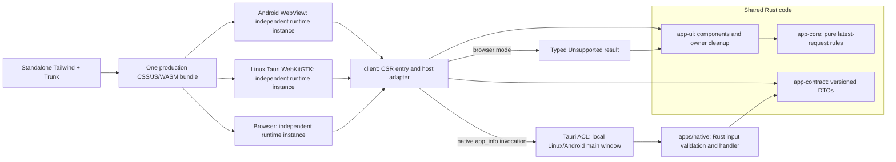
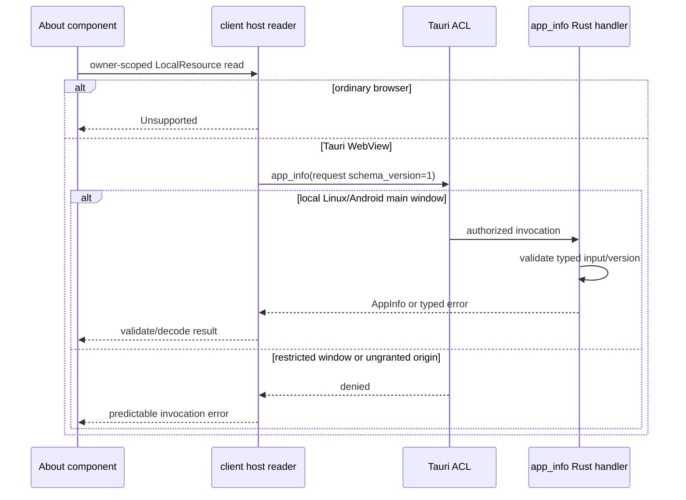
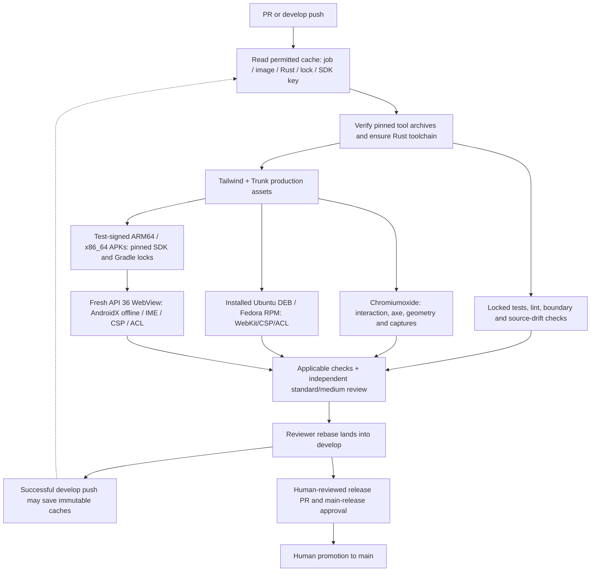
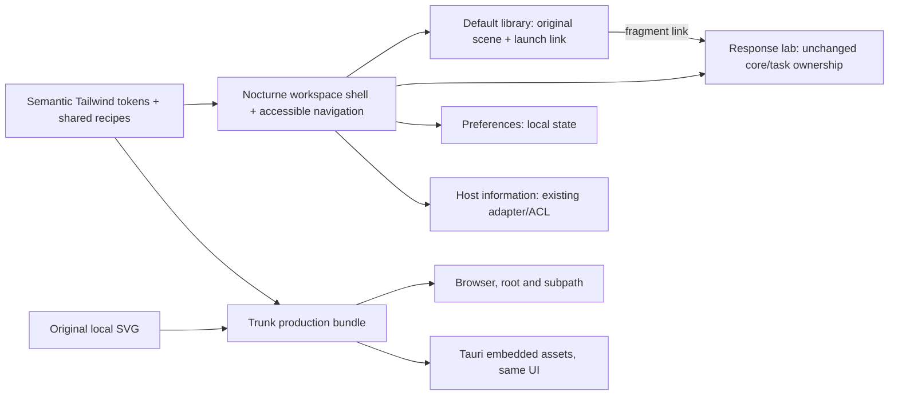
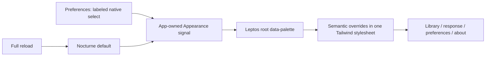
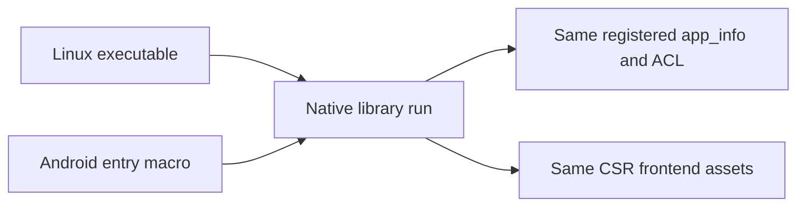
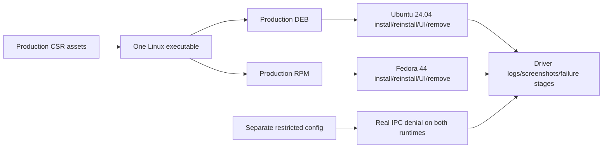
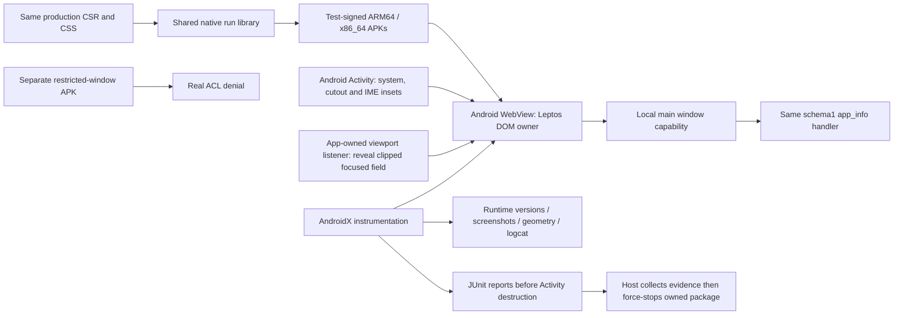

# Architecture decisions and evidence boundaries

## Non-negotiable boundaries

1. Leptos is the only UI/reactivity framework. Its view tree is the sole owner of DOM updates within the application.
2. Rendering modes are **deployment profiles**, not runtime mixins: v0.1 uses CSR on web, desktop, and mobile. Later, web may use SSR + hydration while native shells remain CSR.
3. Tailwind is the single CSS utility pipeline. The build must discover class names used by all shared Leptos components.
4. `app-core` contains pure Rust rules. It must not depend on Leptos, Tauri, `web-sys`, or other platform-only capabilities. Enforce with target-aware dependency checks, not merely documentation.
5. Browser I/O and Tauri IPC are explicit, independently tested adapters. A shared Rust type does not imply shared memory, authority, persistence, or synchronization.
6. No platform is labeled supported without building, launching, and exercising it on the actual platform. iOS requires macOS/Xcode.
7. All toolchain/component versions and feature flags used for releases must be pinned and verified together.

## Workspace and native host

```text
crates/
  app-contract/   # Versioned host boundary, no platform authority
  app-core/       # Pure domain state, transitions, DTOs where appropriate
  app-ui/         # Leptos views and shared presentation logic
  client/         # CSR/WASM entrypoint and browser/Tauri adapter boundary
apps/
  native/         # Tauri 2 shell, permissions, platform commands
styles/           # Tailwind 4 source
proofs/           # Optional extracted Rust definitions and checked Lean theorems
tests/            # Core, browser, and platform integration tests
```

The Linux Tauri host is an isolated Cargo workspace with its own lockfile;
browser-only checks do not require GTK/WebKit development libraries. Both
clients use the same CSR component tree and production stylesheet.

Workspace boundaries are justified by different target compilation and verification concerns, not by automatically creating a crate for every concept.

## Modern implementation baseline

- Use stable Rust **Edition 2024** and workspace **resolver 3**, subject to the selected tools' MSRV. Record `rust-version`, pin the compiler in `rust-toolchain.toml`, commit application `Cargo.lock` and frontend lockfiles, and use locked builds. Update pins through reviewed dependency changes rather than floating `latest` in CI.
- Use the selected Leptos release's documented fine-grained signal, resource, action, routing, and owner-cleanup APIs. Cancel or reject stale async responses and keep blocking work off UI threads. Do not copy deprecated APIs from older examples.
- Use Tailwind 4's CSS-first configuration (`@import "tailwindcss"`, `@theme`, and explicit `@source` paths for shared Rust sources) and the separate `@tailwindcss/cli` package or pinned standalone CLI. Keep complete utility class names visible to source detection, rather than constructing partial names dynamically.
- Tauri custom commands are not automatically restricted merely by adding a capability file. Register application commands with `tauri_build::AppManifest::commands`, define permissions, explicitly select window/platform capabilities, validate IPC inputs in Rust, and test denial. Set a production CSP and avoid remote-content IPC access by default.
- Tailwind 4 and WASM require a documented minimum browser/system-WebView matrix. Test Linux WebKitGTK, Windows WebView2, and Apple/Android WebViews rather than assuming Chromium results cover every target.
- CI should use least-privilege token permissions, commit-SHA-pinned third-party Actions with reviewed updates, dependency/license/advisory checks, and separate unprivileged pull-request checks from signed release jobs. Keep signing credentials out of forks and frontend/WASM artifacts.

## Build and deployment profiles

### v0.1: CSR (required)

- One client build using Leptos and WebAssembly, hosted as static assets for browsers and bundled for Tauri WebViews.
- Prefer documented CSR tooling such as Trunk; verify integration with Tailwind 4's CLI and Tauri 2 against pinned versions.
- Native-only code stays in the Tauri host; bridge it through an explicit contract and least-privilege capabilities.
- Asset bundling may allow offline UI startup, but it does not guarantee offline data or synchronization.

### Follow-up: SSR + hydration (web only; optional)

- Add a server profile based on Leptos SSR, Axum integration, and cargo-leptos after the CSR baseline is validated.
- Keep native builds client-rendered; share components and core rules without requiring an embedded server.
- Verify HTML validity, browser-parser effects, server/client route parity, consistent initial state, hydration and disposal behaviors, asset versions, and JavaScript-disabled behavior.
- Build CSR, hydration, and SSR separately for their intended targets. Do not use `cargo --all-features` to validate mutually exclusive rendering modes; Cargo feature unification can break profile isolation.
- Do not claim hydration correctness has been formally proven unless the proof is connected to the actual implementation and its assumptions are audited.

## Verification strategy

- Default CI: formatting, Clippy, unit/property tests, target builds, browser E2E, and platform packaging smoke tests.
- First formal candidate: a small pure reducer with a real invariant (for example, stale responses cannot overwrite the active request). Evaluate a pinned Charon/Aeneas-to-Lean workflow on supported source functions first, optionally managed by hax's current `cargo hax into lean` and `cargo hax tools` commands. Pin hax, extraction tools, and prover versions together and check the supported Rust subset rather than assuming arbitrary application code is extractable.
- CI must regenerate extracted definitions, check theorems with Lake, audit axiom dependencies and non-vacuity, and test a deliberately broken implementation to establish proof sensitivity.
- Browser DOM/hydration correctness, accessibility, IPC permissions, offline behavior, and release assets require integration testing. Proofs about a separate model do not establish those properties.

## Non-goals

No additional UI frameworks, no generalized cross-platform abstraction framework, no simultaneous deployment of SSR and CSR inside the same Tauri client, and no claim of end-to-end formally verified application behavior.

## Upstream implementation references

Checked during scaffold review; these links do not substitute for testing pinned versions:

- [Leptos](https://leptos.dev/) and [CSR deployment](https://book.leptos.dev/deployment/csr.html)
- [Rust Edition 2024](https://doc.rust-lang.org/edition-guide/rust-2024/index.html)
- [Tailwind 4 CLI](https://tailwindcss.com/docs/installation/tailwind-cli), [source discovery](https://tailwindcss.com/docs/detecting-classes-in-source-files), and [browser compatibility](https://tailwindcss.com/docs/compatibility)
- [Tauri capabilities and application command defaults](https://v2.tauri.app/security/capabilities/)
- [hax Lean backend and tool management](https://github.com/pereq-dev/hax#usage)

## Overall runtime architecture (current)



Sharing code and wire types does not share process state or permission authority.
The browser adapter never grants native authority; the host enforces the ACL and
validates the schema independently. Exact Android evidence is tracked in O-0011;
Windows/macOS/iOS remain unvalidated.

## Host information flow (current)



## Build, verification and review flow



PR jobs do not save trusted caches. Native jobs retain OS package installation,
include SDK versions in cache identity, and rebuild package-owned embedded assets.
Cache contents contain no signing material; release signing remains separate.
Human reviewers use the focused change diagram in each architectural PR alongside
these overall diagrams. Source changes still run the same functional/security
checks; cached builds do not replace verification.

## Default shared UI and static artwork



[Default design](default-design.md) and the [spatial brief](../design/workspace-launcher-brief.md)
describe hierarchy and responsive geometry. Initial empty/unknown fragments show
the library; #/ explicitly opens the response lab. The skip link focuses main
without navigating the fragment router. No game execution, new IPC or persistent
library state is implied. Static artwork is bundled locally alongside the one
production stylesheet and CSR assets.

## App-session color selection



The signal outlives route owners but not the app; it does not use persistence,
IPC or app-core. Feedback colors are presentation of existing request states.
See [color scheme contract](color-palettes.md).

## Shared native entry point



The isolated native workspace now exposes `rust_ui_native_lib::run()` and keeps
the Linux executable as a thin caller. Linux-only x11/dbus features are scoped
to that target. The generated Android host is implemented; its runtime evidence and limits are
recorded separately in O-0011. This entry-point extraction alone is not launch evidence. Wire schema stays 1.

## Linux package validation



Production package artifacts exclude restricted fixtures. See
[Linux package instructions](linux-packages.md) for exact validation boundaries.

## Android host and verification



The Android project is generated with the pinned Tauri CLI and then reviewed as
source; only machine-specific bridges/JNI/build outputs are regenerated. Its
Android-safe application ID is distinct from Linux's package identity; wire
schema and pure core remain unchanged. Host root padding owns insets; the shared
DOM owns layout and its focused-field scrolling adapter. No Node or embedded automation server is introduced.
Current Android build and runtime evidence/limits are recorded in
[O-0011](../knowledge/observations/O-0011-android-apks.md), not inferred from the
diagram. Linux packages are already validated separately.
