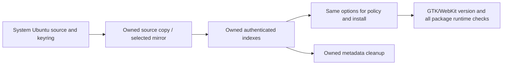

# CI runtime, cache boundaries and measurement

Contributors must continually inspect affected workflows for efficiency and
idempotency within their change scope. The [contributor rules](../CONTRIBUTING.md#ci-efficiency-and-idempotency-are-contributor-responsibilities)
make measurement, safe repeated setup, optional caches and retained verification
part of review, rather than a one-time optimization task.

The native baseline [run 42908982231](https://github.com/kmosoti/rust-ui-template/actions/runs/42908982231)
(job 130154305222) took 14m20s on Ubuntu 24.04:

| Step | Seconds |
| --- | ---: |
| Compile/install Trunk | 342 |
| Native production build | 191 |
| Frontend build | 85 |
| Native Clippy | 81 |
| OS prerequisites | 27 |
| Install tauri-driver | 22 |
| Ensure Rust/toolchain components | 11 |

The workflow now uses the official Trunk 0.21.14 binary verified by a committed
SHA-256, replacing source compilation. `scripts/setup_ci_tools.py` checks cached
archive bytes and re-extracts the binary on every use. A modified executable is
not accepted just because its filename/version metadata looks right.

## Cached state and invalidation

The local composite actions restore/cache Cargo registry/git data, compiled root
and isolated native targets, Trunk's tool cache and `.tools/`. Keys distinguish
OS, architecture, runner image, job profile, Rust version, both lockfiles, installer
scripts, tool manifest and native GTK/WebKit SDK versions. Missing image-version
metadata falls back to a run-specific key instead of sharing unknown images.
Compatible dependency caches can be restored across lock changes; Cargo still
resolves/builds with the committed locks and checks source/features normally.
Root/native project source is never supplied by the cache. Native packaging
cleans its own release package before rebuilding embedded production assets,
so a cached restricted fixture cannot substitute for the production package.

Only successful `push` jobs on `develop` save caches. PRs restore the permitted
base cache but do not publish trusted executable caches. GitHub's service-level
branch scoping complements the workflow guards. Do not switch these jobs to
pull_request_target or restore these build outputs into a privileged signing
workflow. No credentials or signing material belong in a cache.

Cache keys are immutable; a hit does not overwrite an existing entry. Source
changes rebuild through Cargo fingerprints, and misses use the same verification
pipeline. CI disables incremental compilation and dev/test debuginfo to reduce
cache size; local development profiles remain unchanged. Change the cache epoch
when cache layout/tool semantics require a clean reset. Monitor restore time,
cache size and eviction before adding more cached paths.

Fresh hosted runners still install OS libraries and ensure the pinned Rust
components. Restoring /usr or a package database is not supported. The measured
OS step was 27s; Trunk compilation was the dominant repeated installation.
The tauri-driver Cargo installation uses a cached dedicated install root and
skips recompilation when the pinned version is already installed.

## Measure cold and warm runs separately

Use the GitHub jobs API response after completion:

```sh
gh api repos/kmosoti/rust-ui-template/actions/runs/RUN_ID/jobs | python3 scripts/ci_timings.py
```

Record run/source, runner image/SDK, result, matched cache key and hit/miss, tool
setup time, build time, restore/save cost and job wall time. A first PR can miss
all trusted caches; the first successful develop push seeds them. A rerun of the
same develop source can then demonstrate warm reuse. Do not label a fast local
build or a cold prebuilt-tool run as a measured warm CI speedup. Results and
limitations are tracked in [O-0006](../knowledge/observations/O-0006-design-ci.md).

## Observed results (2026-11-10)

| Job | Prior baseline | New cold PR | Warm exact-hit rerun |
| --- | ---: | ---: | ---: |
| Browser | 8m51s | 2m15s | 44s |
| Core | Not compared | 3m28s | 26s |
| Linux native | 14m20s | 9m06s | 3m00s |

Warm runs used the same develop source after a successful push seeded each cache.
Times include cache transfer and all applicable checks. Native warm restore cost
20s for ~880 MiB; installed production/CSP and restricted-window denial tests
passed. These are single observed runs with runner variability, not guarantees.
Run/attempt links, image/SDK/key, seed costs and commands are in
[O-0006](../knowledge/observations/O-0006-design-ci.md).

## Human review

[Overall architecture](architecture.md) and the [change diagrams](design-ci-change.md)
show ownership and cache trust. All existing lock, format, lint, boundary,
mutation, browser, native permission/CSP and source-drift checks remain. Browser
CI also uploads `browser-ui-evidence` with screenshots and geometry JSON; native
CI retains its separate unsigned package/screenshot artifact. The template's
reviewers use standard/medium effort; max and ultra are prohibited for review.


## Linux and Android delivery profiles

Linux packaging now builds DEB/RPM once, preserves production copies/hashes, and
validates install/reinstall/metadata/launch/removal on Ubuntu 24.04 and Fedora 44.
Separate restricted fixtures must pass real denial without overwriting production
artifacts. Fedora runtime dependencies are installed in a digest-pinned container;
no system package-database snapshot is restored.

Android has an isolated cache profile for Cargo/Gradle dependencies, wrapper
archives, verified installed SDK/NDK/emulator trees and target builds. Keys include
runner/Rust/JDK, SDK manifest, Gradle scripts, generated locks and checksum metadata.
Normal builds verify dependencies strictly; the update-only metadata helper never
runs in CI. Mutable AVD/user homes, debug keys and SDK ZIP staging are excluded.
SDK ZIPs are discarded after verified installation, saving about 3.3 GB of staging
space before the VM starts. Each ABI's own native package is cleaned before
embedding current production frontend assets; dependency compilation stays cached.

The API 36 VM uses explicit SDK-user/emulator/AVD homes, an owned serial, fresh
fixture data, KVM and SwiftShader. Early process exit prints bounded diagnostics
and fails promptly. Assertions are never automatically replayed. Browser/native
checks, artifact hashes and source-drift checks remain required; unsigned/test-
signed build evidence is separate from production release signing.

Local repeated SDK-tree verification measured 6.09 s and 4.92 s without downloads;
these hot-filesystem samples are not CI warm-cache speedup measurements. Exact
runs, failures and pending measurements live in [O-0010](../knowledge/observations/O-0010-linux-packages.md)
and [O-0011](../knowledge/observations/O-0011-android-apks.md).

## Clean frontend reproducibility gate

`python3 scripts/check_frontend_repro.py` builds the exact checked-out commit in
two independent clean clones/empty Cargo target directories without restoring
compiled caches. It uses a fixed source epoch and remaps checkout paths, compares
all production file names/bytes, and executes workspace tests plus root/subpath
production browser checks from the first fresh clone. Registry source downloads
may be reused; they are not compiled-build cache evidence. Reports retain source,
commands, environment policy, timings and SHA-256 manifests. This proves only the
configured frontend build on the pinned runner; unsigned native package and
signed-release byte determinism remain separate follow-up work (#24).

The dedicated security workflow caches only registry sources and verified tool
archives, avoiding compiled native/browser targets that it does not use.
Successful develop pushes alone save those caches. Its evidence records initial
and repeated actual tool-setup durations; archive hits still reverify bytes.

The clean frontend gate is conditional: prose and isolated `apps/native/**` /
`vendor/**` changes do not rebuild unchanged browser assets. All other paths,
including scripts, workflows, toolchain pins and browser fixtures, conservatively
trigger it. A coverage guard checks actual tracked frontend inputs against both
PR/push ignore lists. If the browser workspace ever consumes native/vendor code,
remove those ignores as part of that architecture change. Dependency-security
coverage remains independent and is not narrowed by this optimization.

## Completion measurements (2026-11-11)

Same source323167e3, Ubuntu24.04 image20261101.360.1: dependency-security seed
run42982373154/attempt1 passed31s and saved its verified dependency/archive cache
in4s; exact-hit attempt2 passed24s including4s to restore156MiB. Both executed all
checks. Warm verified setup calls took0.141s/0.366s. These are single paired samples,
not a universal speedup claim. The initial exact-head cold tool setup was1.054s,
then0.207s on repeated setup within the job.

Actual Android run42981139718 passed7m25s: cache transfer61s, tool setup2s,
SDK verification11s, ABI builds147s and production/denial VM checks159s. Larger
cache transfer work is tracked in #31; no test coverage is traded away for speed.
See [O-0017](../knowledge/observations/O-0017-issue1-completion.md) for exact commands,
cache trust, per-run evidence and source/environment limitations.

## Android cache experiments

The Android job records `android-cache-profile` JSON immediately after restore
and after successful verification. Each non-overlapping root has apparent and
allocated bytes plus immediate-child breakdowns; do not sum parent and child
figures. Source, runner image, cache key/hit and profiler overhead are included.
GitHub's cache API supplies compressed archive sizes separately.

For a controlled cold PR run, add the `ci-cache-cold` label; this skips restoration
without changing source. Remove it for normal restored runs. Label events only
run Android for this particular control. PRs never save caches; only a successful
trusted develop push seeds them. Record a cold run, seed and three warm runs with
the same application source/toolchain/image. Keep all actual APK, production,
denial, image, dependency, hash and source-drift checks. Cache partitioning alone
is not evidence of a faster job; report any storage benefit separately.


### Owned Ubuntu dependency setup

`bash scripts/setup_linux.sh` creates one private Ubuntu source declaration and
signed index set, applying the same explicit options to update/policy/install.
Only Ubuntu package sources are needed for this package group. The system source
file, keyring, suites/components and validity checks remain authoritative; a
reachable third-party mirror changes transport, not trust. No system apt-list
snapshot is restored. Metadata is removed on normal/error/signal exit; forced
SIGKILL still relies on ephemeral runner cleanup. The job bounds setup to10min.



This isolates observed index/configuration inconsistency; it does not establish
its underlying cause. O-0018 retains failed runs and fresh/repeated evidence.
### Android cache partitions

The retained v2 layout separates `.tools/android-sdk`, dependency/tool/Gradle state and
compiled frontend/native targets. Keys include runner image and relevant input fingerprints. The SDK is exact;
dependency/target fallback retains the same tool/setup/build compatibility
tuple and varies only lock/verification identity. Targets additionally hash vendored sources and workflow
build flags. Full SDK byte verification, source-drift checks, strict Gradle
verification, both ABIs and real production/denial emulator checks remain.
PRs cannot save any partition; the cold label skips all restores. A successful
develop push seeds only missing components, then exact-source reruns measure warm
behavior. Profiles retain each component primary/matched key and exact-hit status. No AVD, signing keys or system
directories are cached.

The cold/seed/three-warm trial retained this layout for independent SDK reuse,
not transfer speed. Corrected warm median391s versus v1 median384s was1.82%
slower, within the10% trial gate; restore median82s versus72s was13.89% slower.
Source/harness changes, small samples and archive freshness limit comparison.
[O-0020](../knowledge/observations/O-0020-android-cache-partition-trial.md)
retains all measurements, the canceled shutdown stall, synthetic fallback proof
and decision limits. #31 remains open for transfer latency and longer-term reuse.
Reconsider the simpler layout if reuse no longer justifies the cost; preserve
measurement tooling and unsuccessful evidence.


Use `ci-cache-stale` on a PR for a synthetic primary-key mismatch in dependency/
target partitions. After a trusted seed, this exercises compatible fallback;
SDK stays exact. Cold wins if both labels exist. Profiles report matched key,
primary key and probe status. This is not a dependency-upgrade test. Both label
controls are read-only for caches and irrelevant label events cannot cancel the
real Android validation job.
