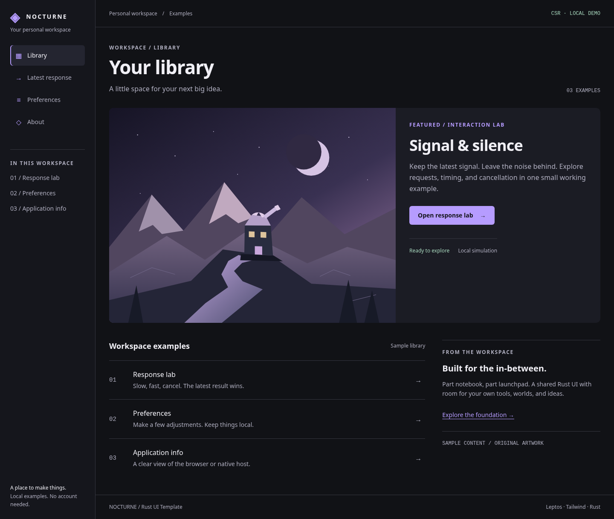

# Nocturne: the default workspace launcher

The template's default is a dark workspace/library hybrid, requested by the user:
Obsidian-like persistent workspace organization, with the featured artwork,
clear launch action and library hierarchy of Riot/Steam-style launchers. It uses
an original name, illustration and component styling; no product branding or
external asset service is required. These references describe interaction and
spatial character, not affiliations or copied interfaces.

## Preview

Actual production desktop capture (1440 CSS px):

[Mobile capture at 320 CSS px](images/nocturne-mobile.png). These are implemented
browser captures; execution provenance and limitations are in
[O-0007](../knowledge/observations/O-0007-workspace-launcher.md).

## Composition

- A 224px workspace rail on desktop keeps the library, lab, preferences and host
  information available. It becomes wrapping top navigation below 1024px.
- A quiet context bar establishes the workspace. The main content has a maximum
  width and flexible gutters instead of a fixed viewport height.
- The library opens by default. One featured scene and its primary action create
  hierarchy; rows below expose actual examples rather than decorative metrics.
- A launch opens a local example. This is a UI template, not a game launcher,
  installer, account system or real content library. Sample copy is labeled.
- The response, preferences and host-information routes use the same semantic
  tokens, control recipes and typography. Their behavior/authority is unchanged.

## Tokens and recipes

Active tokens live in [styles/input.css](../styles/input.css), which resets the
stock color and radius namespaces for the whole shared build. Use complete
semantic classes or the existing component recipes; don't reintroduce unrelated
stock colors into a route. A product-specific brief may deliberately replace
this default through a reviewed complete migration.

| Token | Role |
| --- | --- |
| canvas / sidebar / panel / raised | Ground, workspace, feature surface, active navigation |
| ink / muted | Primary text and readable secondary text |
| brand / action-ink | Selected primary action and its readable foreground (lavender in Nocturne) |
| info / success / warning / danger | Feedback roles paired with explicit text |
| hairline / control | Decorative separators / visible control boundaries |
| radius-control / radius-art | Small control corners / artwork clipping |

Use `primary-action`, `secondary-action`, `field`, `page-heading`, and
`page-summary` for consistent task hierarchy. Body text uses system sans;
monospace is limited to small metadata. No font download or animated carousel is
required. Focus is visible, navigation exposes aria-current, and the keyboard
skip link focuses main without changing the fragment router. Mobile content
scrolls naturally; text can wrap at narrow and enlarged sizes.

The original [observatory SVG](../public/observatory.svg) is copied by Trunk into
the same static bundle as CSS/WASM. Relative URLs work at root and a deployment
subpath. Art and feature text occupy separate areas, keeping text contrast
independent of the artwork. Preserve image dimensions/alternative text and test
actual production loading when changing it.

## Selectable colors

Six additional [color schemes](color-palettes.md) are available in Preferences.
They reuse the Nocturne layout and semantic recipes; the app-session choice
survives navigation and resets on reload. Nocturne remains the default.

## Working with the default

Use the [distinct UI skill](../.agents/skills/distinct-ui/SKILL.md) and
[layout brief](../design/workspace-launcher-brief.md). New features should fit
this default unless the user's brief establishes another identity; geometry,
state behavior and rendered verification still matter. A default is a useful
starting design, not evidence that every later task is solved by the same layout.

The browser runner audits all four routes at desktop, 390px and 320px, plus
320px with 200% text. It checks keyboard skip/launch, current navigation,
production CSS/WASM/artwork (including /sub), cancellation and axe smoke.
Native CI checks actual installed asset loading plus the existing command,
CSP and denied-window paths. See [O-0007](../knowledge/observations/O-0007-workspace-launcher.md) for executed
results and visual critique.
