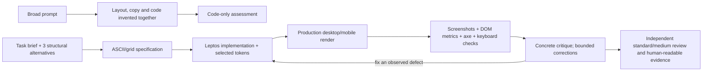
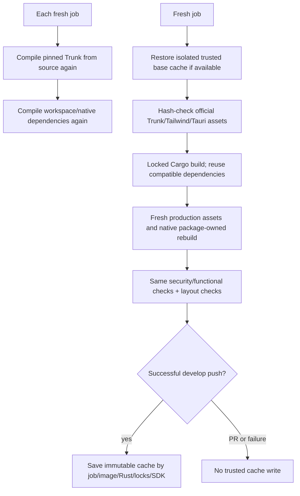

# Design workflow and CI changes for human review

Overall architecture: [architecture.md](architecture.md). Research:
[R-0002](../knowledge/research/R-0002-ui-diversity-and-verification.md).

## Design workflow change

The local skill guides new work; it does not claim the existing sample dashboard
is a unique design or force all products to adopt an industrial theme. Namespace
restrictions are an optional profile with an actual CSS-output check.

## CI setup change

CI disables incremental/debuginfo-heavy test artifacts to keep caches smaller;
local developer profiles are unchanged. Cache misses remain supported. OS
packages are freshly installed; the baseline measured cost was 27s, compared with
342s spent compiling Trunk. Cold and warm measurements must be reported separately.
This change neither removes native permission/CSP tests nor merges into main.
